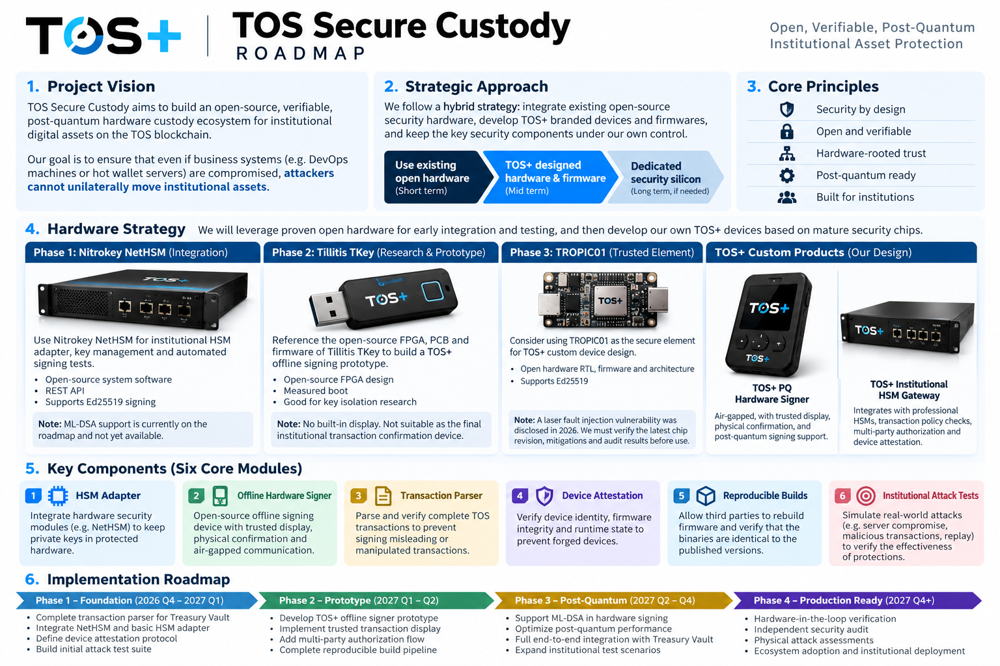

# TOS Secure Custody

**Open and verifiable custody infrastructure for TOS. Advancing post-quantum hardware custody.**

> **Experimental / inspection-only. Do not use with real funds.**
> This bootstrap is not a production wallet, hardware product, certified HSM, or audited custody system.
> Production signing is deliberately disabled. No post-quantum hardware integration is claimed.

Target repository: `tosnetwork/tos-secure-custody`  
Version: `0.1.0.dev0`  
Project language: English  
Software license: Apache-2.0

## Mission

Make a compromised business host insufficient to unilaterally move institutional treasury assets.
Combine independent transaction interpretation, separated approval roles, hardware-protected keys,
and the existing TOS Treasury Vault's on-chain enforcement. Publish the source, evidence, assumptions,
and remaining gaps so institutions can independently verify the actual security boundary.

A key that cannot be exported can still sign an attacker-selected transaction. Protecting keys and
authorizing intent are separate requirements. No single vendor, workstation, administrator, RPC
endpoint, build server, or attestation service should silently become the sole withdrawal authority.

## Roadmap



## Six workstreams

| Workstream | Included in this bootstrap | Not yet delivered |
|---|---|---|
| HSM adapters | Explicit capability interface; experimental NetHSM Ed25519 transport; pinned-key signature verification; fail-closed PKCS#11 placeholder | Physical-device validation, production PKCS#11, hardware ML-DSA |
| Offline hardware signer | Bounded offline request format, inspection CLI, host-label rejection, explicit signing-disable gate, hardware/firmware requirements | Device firmware, trusted display, physical approval, QR transport, custody signing |
| Complete transaction parser | Strict ordinary-cell BOC parser; all nine pinned Vault V1 entry points; payment and management payloads; full supported internal-message envelope | External wallet envelopes, wallet signing preimages/actions, authenticated state proofs, native differential conformance |
| Device attestation | Session/key/intent-bound protocol design; cryptographically verified software fixtures; challenge replay and rollback tests | Actual TPM/DICE/secure-element evidence, hardware endorsements, durable verifier state |
| Reproducible builds | Deterministic source packaging, content manifest, two-directory byte comparison, SHA-pinned checkout action | Hash-locked toolchains/dependencies, reproducible firmware/wheels, independent builder signatures |
| Institutional attack acceptance | Executable software adversarial tests, seeded parser smoke inputs, targeted guard-removal controls, hardware/native acceptance matrix | Hardware-in-the-loop attacks, native wallet-to-Vault execution, physical attacks, independent expert review |

**“Complete parsing” is a release requirement, not an assertion that this bootstrap supports every
TOS transaction.** It fully consumes the explicitly supported Vault schemas and refuses unknown
formats. It never authorizes an external wallet signature from a partially decoded request.
See [implementation status](IMPLEMENTATION_STATUS.md).

## Intended architecture

```text
Untrusted business host / coordinator
                  |
                  | exact unsigned transaction + independently verifiable context
                  v
        Independent parser and policy evaluator
             /                    \
   Business-role device       Guardian-role device
       hardware key          independent intent source
             \                    /
              TOS role-wallet authentication
                         |
                         v
              Treasury Vault V1 contract
          typed payments / budgets / role separation
                         |
                    TOS settlement

Separate cold PQ multisig -> delayed governance
Separate emergency pauser -> pause only
Attestation + reproducible builds -> supporting evidence, not payment authority
```

The architecture is the target, not a diagram of an already deployed system. The current command line
only inspects requests and performs diagnostic policy comparisons. It cannot sign or broadcast.
The low-level NetHSM adapter is a protocol prototype and must not be exposed as an unrestricted service.

## Quick start

Use Python 3.11-3.13 and an isolated development environment:

```sh
python3 -m venv .venv
. .venv/bin/activate
python3 -m pip install -r requirements-test.txt
PYTHONPATH=src python3 -m tos_custody status
PYTHONPATH=src python3 -m tos_custody inspect-bundle examples/native-payment.offline.json
PYTHONPATH=src python3 -m tos_custody check-bundle examples/native-payment.offline.json \
  --policy examples/diagnostic-policy.json --now 1793491200
python3 scripts/validate.py
python3 scripts/mutation_controls.py
python3 scripts/check_reproducible.py
python3 scripts/check_release_readiness.py
```

The final command **must exit nonzero**: production release is blocked. CI uses
`--expect-blocked` to assert that the bootstrap has not accidentally enabled production signing.
All example addresses, network IDs, timestamps and amounts are synthetic. The fixture network ID is
`-777777`; it is not a claim about any deployed TOS network. No example includes a production secret.

## TOS integration baseline

The initial wire profile is pinned to TOS commit
`def735f3ad9c57a4b8fc8de43537075baec2271a`, the Treasury Vault V1 merge.
It is a compatibility baseline, not an assertion that it is the latest `main` commit.

The Vault authenticates internal-message senders, not device attestations or detached JSON signatures.
Its production deployment requirement is post-quantum authentication for all four role accounts,
with a post-quantum multisig at the immutable cold-administrator address. The exact account code,
network configuration and deployed state must be verified before integration can authorize funds.

An off-chain custody manifest hash, a Vault request cell hash and the role wallet's actual signing
preimage are **different objects**. This project does not substitute one for another.
See [integration](docs/TOS_INTEGRATION.md) and [pinned sources](docs/UPSTREAM_BASELINE.json).

## Documentation

Start with the [project charter](docs/PROJECT_CHARTER.md), [threat model](docs/THREAT_MODEL.md),
[architecture](docs/ARCHITECTURE.md), [roadmap](docs/ROADMAP.md),
[attack acceptance matrix](docs/ACCEPTANCE_MATRIX.md), and [security policy](SECURITY.md).
The [hardware requirements](docs/HARDWARE_REQUIREMENTS.md) describe what “open” and “verifiable”
must mean at each layer rather than treating open source as a security certificate.

## Publishing this standalone project

This package is ready to initialize an independent repository. It does not modify `tosnetwork/tos`.
The preparation environment could read and edit existing GitHub repositories but did not expose
repository creation; the target returned HTTP 404. No remote publication is claimed by this package.

After reviewing the files, use your own authenticated GitHub CLI account with permission to create
repositories in `tosnetwork`:

```sh
bash scripts/publish_github.sh --public
python3 scripts/publish_issues.py
```

The first command refuses an existing local Git repository or accessible remote target and never
force-pushes. It needs an existing Git author configuration. The second creates one epic and six
English workstream issues, avoiding exact-title duplicates. Neither command was executed against
GitHub during bootstrap preparation. Organization access controls, rulesets, required reviews,
security reporting and release ownership remain administrator setup tasks.

## Security and evidence

Do not fund, deploy, or market this prototype as production-secure or hardware-qualified.
Local tests are not native TVM execution; mocked transport is not a physical HSM; signed software
claims are not hardware attestation; source-archive equality is not reproducible firmware.
See [evidence](evidence/README.md), [release gates](docs/RELEASE_GATES.md), and
[contribution rules](CONTRIBUTING.md).
